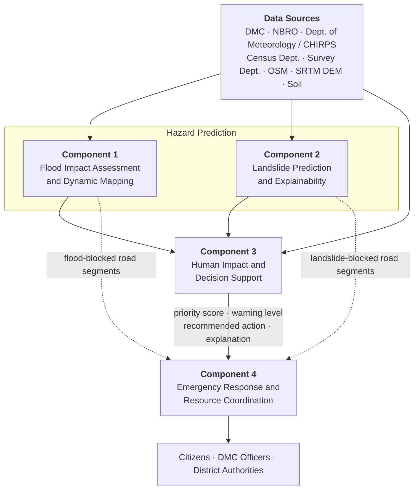

<div align="center">

# Integrated Flood and Landslide Risk Assessment and Response System for Sri Lanka

**Project ID: J26-IT-334**

Final Year Research Project, B.Sc. (Hons) Degree in Information Technology
Department of Information Technology, Sri Lanka Institute of Information Technology (SLIIT)

[Risk Atlas Demonstration](https://map-cmp.vercel.app/) | [Integrated Prototype](https://sri-lanka-3-d-map.vercel.app/)

</div>

---

## Document Control

| Item | Detail |
|---|---|
| Project ID | J26-IT-334 |
| Document | Project README and research summary |
| Version | 1.0 |
| Last updated | October 2026 |
| Institution | Sri Lanka Institute of Information Technology (SLIIT) |
| Research cluster | Center of Excellence for AI (CEAI) |
| Supervisor | [To be confirmed] |
| Co-supervisor | [To be confirmed] |
| Repository status | Active development (research prototype) |

---

## Contents

1. [Abstract](#abstract)
2. [Introduction and Problem Statement](#introduction-and-problem-statement)
3. [Research Gap](#research-gap)
4. [Research Aim, Objectives and Questions](#research-aim-objectives-and-questions)
5. [Existing Systems and Limitations](#existing-systems-and-limitations)
6. [Target Stakeholders and Communities](#target-stakeholders-and-communities)
7. [System Architecture](#system-architecture)
8. [Research Components](#research-components)
9. [Data Sources](#data-sources)
10. [Technology Stack](#technology-stack)
11. [Methodology, Benchmarks and Validation](#methodology-benchmarks-and-validation)
12. [Prototype Status](#prototype-status)
13. [Scope and Limitations](#scope-and-limitations)
14. [Project Progress](#project-progress)
15. [Repository Structure](#repository-structure)
16. [Installation and Usage](#installation-and-usage)
17. [Commercialisation Outlook](#commercialisation-outlook)
18. [Alignment with Sustainable Development Goals](#alignment-with-sustainable-development-goals)
19. [Data Ethics and Licensing](#data-ethics-and-licensing)
20. [Research Team](#research-team)
21. [How to Cite](#how-to-cite)
22. [Contact](#contact)
23. [Acknowledgements](#acknowledgements)
24. [References](#references)

---

## Abstract

Floods and landslides are among the most frequent and damaging natural hazards in Sri Lanka. National records for 2010 to 2025 report approximately 14.4 million people affected, nearly 1.5 million displaced and 2,218 deaths [1]. Existing early warning arrangements are comparatively mature in hazard detection and monitoring but weaker in impact-based communication and operational response [2]. Hazard information is typically produced separately for each hazard, is rarely combined with population vulnerability, and is not directly converted into resource dispatch decisions.

This project proposes an integrated decision-support system composed of four cooperating components: (1) flood impact assessment and dynamic mapping, (2) probabilistic and explainable landslide prediction, (3) human impact estimation and decision support at Grama Niladhari division level, and (4) emergency response and resource coordination using constraint-based optimisation and hazard-aware routing. Components exchange structured outputs through versioned application programming interfaces, so that hazard severity is progressively transformed into prioritised alerts, resource allocation and safe routes. The system targets Sri Lanka's disaster management authorities, with the Disaster Management Centre as the primary user, and is evaluated through baseline comparison, spatial cross-validation, historical event backtesting and scenario-based simulation.

**Keywords:** multi-hazard early warning; landslide prediction; explainable machine learning; human impact assessment; disaster decision support; resource allocation; hazard-aware routing

---

## Introduction and Problem Statement

Sri Lanka's monsoon rainfall, mountainous central highlands and extensive river systems expose it to recurrent floods and landslides. Compound flood and landslide events were responsible for more than 6.4 million affected people and 479 deaths between 2010 and 2025 [1]. Cyclone Ditwah (2025) affected approximately 2.2 million people across all 25 districts [17].

Four problems motivate this work.

1. **Fragmented hazard prediction.** Flood and landslide warnings are produced separately, and landslide assessment is often static (zonation maps) rather than probabilistic and explainable.
2. **Hazard is not impact.** A severity warning does not indicate how many people are likely to be affected, which groups are most vulnerable, or which area should be served first [2], [3].
3. **Manual response coordination.** District-level coordination relies largely on telephone and radio communication, with no shared view of the availability of ambulances, boats and shelters.
4. **Hazard-blind routing.** General-purpose routing services cannot exclude road segments that are blocked according to locally derived flood and landslide data.

---

## Research Gap

Three lines of evidence define the gap addressed by this project.

- National records show that human impact varies independently of hazard frequency, and that flood and landslide combinations affect the largest populations [1].
- A regional evaluation of multi-hazard early warning systems found that Sri Lanka's detection and monitoring capability is comparatively strong, while risk knowledge and impact-based communication are weak, and standardised vulnerability data are not incorporated in warning processes [2].
- Existing Sri Lankan and regional systems each address only a partial slice of the problem (see [Existing Systems and Limitations](#existing-systems-and-limitations)).

**Stated gap:** there is currently no validated, Sri Lanka-specific pipeline that converts multi-hazard flood and landslide severity into an explainable, vulnerability-aware human impact estimate at Grama Niladhari division level, and then into a resource-verified, hazard-aware dispatch decision.

---

## Research Aim, Objectives and Questions

**Aim.** To design, prototype and evaluate an integrated flood and landslide risk assessment and response system that supports Sri Lankan disaster management authorities.

**Component objectives**

| Component | Objective |
|---|---|
| 1. Flood | Estimate flood severity and impact and present it through dynamic, localised web-GIS mapping |
| 2. Landslide | Predict landslide occurrence probabilistically with explainable, factor-level outputs |
| 3. Decision support | Convert hazard severity into an explainable, vulnerability-aware human impact estimate and a graded, actionable alert at Grama Niladhari (GN) division level |
| 4. Emergency response | Verify live resource availability, allocate resources under scarcity, generate hazard-aware evacuation and rescue routes, and dispatch alerts in Sinhala, Tamil and English |

**Research questions**

- **RQ1.** Can ensemble models (Random Forest, XGBoost, LightGBM) improve landslide prediction over a logistic regression baseline in the study area, and which factors contribute most?
- **RQ2.** Does combining hazard severity with demographic vulnerability and infrastructure accessibility identify high-impact divisions more accurately than hazard severity alone?
- **RQ3.** Can an optimisation-based, hazard-aware coordination engine allocate and dispatch resources more efficiently than manual or heuristic dispatch under the same constraints?

---

## Existing Systems and Limitations

*Table 1: Existing systems and their limitations relative to this project.*

| System | Description | Principal limitation |
|---|---|---|
| DMC Disaster Risk Index [15] | National risk classification from hazard, population and infrastructure indicators | Compiled as a static report; does not respond to live hazard severity |
| DMC and IWMI forecast-based warning platform | Real-time forecasting | Single hazard at a time; no shared population-aware decision layer |
| Donate.lk [9] | Matches donated items to requests; routes a single team through a third-party maps service | No live resource availability check; routing cannot exclude hazard-blocked segments |
| DREMS [7] | Indian platform with a priority-weighted allocation optimiser | District-level accessibility score rather than road-segment exclusion; built for India's agency structure |
| ResQConnect [8] | Agentic pipeline converting citizen reports into task plans and routes | Reactive; no prior resource availability verification or explicit hazard-based road exclusion |
| Manual district coordination | Telephone and radio | No shared resource visibility, optimisation or outcome logging |

---

## Target Stakeholders and Communities

*Table 2: Government and institutional stakeholders.*

| Stakeholder | Role in the project |
|---|---|
| Disaster Management Centre (DMC) and District Disaster Management Coordinating Units | Primary end users; early warning, coordination, resource inventory, historical records and data partner |
| National Building Research Organisation (NBRO / NBRI) | Landslide hazard zonation, historical inventory, rainfall thresholds, inspection data |
| Department of Meteorology | Rainfall and weather inputs |
| Irrigation Department | River, reservoir and water-level information relevant to flood assessment |
| Department of Census and Statistics | 2024 Census population, age and disability indicators |
| Survey Department | Administrative and GN division boundaries |
| Road Development Authority | Road and bridge network and damage information |
| District and Divisional Secretariats | Local decision making, relief distribution and community coordination |
| 1990 Suwa Seriya | Ambulance fleet and station data |
| Tri-Forces, Police, local authorities and health sector | Intended end users for rescue, evacuation, shelter and medical response |
| Non-governmental and humanitarian organisations | Secondary users; relief planning and optional licensed analytics access |

*Table 3: Target communities.*

| Community | Rationale |
|---|---|
| Landslide-prone hill-country communities: Nuwara Eliya District (Walapane, Ambagamuwa, Kotmale), Kegalle and Ratnapura | Steep terrain, plantation settlements, recurring cutting and slope failures |
| Flood-prone river basin communities: Kalu Ganga and Kelani Ganga basins | Repeated seasonal and flash flooding |
| Vulnerable groups: children, older adults, persons with disabilities, economically vulnerable households | Greater evacuation difficulty and lower recovery capacity |
| General public (free citizen tier) | Localised, plain-language risk information and alerts, including SMS access on basic phones |

The primary user persona is a District Disaster Management Officer responsible for coordinating response across several divisions during an active event.

---

## System Architecture



*Figure 1: High-level system architecture and data flow between components.*

**Component interdependencies**

- Components 1 and 2 are independent of each other and are developed in parallel.
- Component 3 depends on the outputs of Components 1 and 2. It determines priority from severity and does not recompute severity.
- Component 4 depends on the prioritised alerts of Component 3. It determines action from priority and does not recompute risk.
- Components communicate through versioned REST interfaces exchanging structured JSON, supplemented by a shared PostGIS spatial database for common layers (road network, boundaries, resource locations). Each component can therefore be developed and tested independently using mock payloads.

---

## Research Components

### Component 1: Flood Impact Assessment and Dynamic Mapping

*Repository folder:* `Flood Severity Mapping`  
*Researcher:* Sinhalagoda S.A.U.R.A.V  
*Study area:* Kalu Ganga and Kelani Ganga river basins

| Module | Description |
|---|---|
| Multi-source data fusion | Combines rainfall, river level, terrain and historical flood data |
| Flood severity and impact prediction | Produces a flood severity score supplied to Component 3 |
| Localised web-GIS mapping | Dynamic presentation of flood extent and severity |

*Detailed model and dataset description: [to be provided by the component researcher].*

### Component 2: Landslide Prediction

*Repository folder:* `model/cp_landslide`  
*Researcher:* Bagya R M S (IT23394124)  
*Title:* Probabilistic Assessment and Forecasting of Landslide Occurrences  
*Study area:* Nuwara Eliya District (Walapane, Ambagamuwa, Kotmale and neighbouring divisions)

| Module | Description |
|---|---|
| Multi-factor probability engine | Landslide probability from rainfall, soil type, historical landslide inventory and DEM-derived slope angle |
| Explainable terrain failure analysis | SHAP and LIME decompose predictions into environmental and human-influenced factors (slope cutting, deforestation, drainage blockage) |
| Localised web-GIS mapping | Map-based presentation of landslide probability |

*Progress.* An event and control dataset has been prepared and preprocessed (958 records: 479 events and 479 controls) with rainfall, soil, elevation and slope attributes. Model comparison of logistic regression (baseline), XGBoost and LightGBM is in progress, using spatial cross-validation with buffering [12].

*Planned work.* A graded Landslide Severity Index and a factor-contribution view for decision makers.

*Target metrics.* AUC-ROC of at least 0.86, accuracy of at least 86%, recall of at least 0.80, and inference time below one second.

### Component 3: Human Impact and Decision Support

*Repository folder:* `Human-Impact-Assessment-and-Decision-Support`  
*Researcher:* Prathibhani Y.L.O.L (IT23317512)  
*Coverage:* Ratnapura, Kegalle, Kothmale, Ambagamuwa and Walapane, at GN division level

This component is the decision layer between hazard prediction and response. A composite score based on the **Hazard x Exposure x Sensitivity / Capacity** framework is classified into four risk classes: Low, Moderate, High and Critical.

| Part | Description |
|---|---|
| Human impact prediction engine | GeoPandas spatial fusion of hazard severity with population, age, disability and infrastructure accessibility data; classification using logistic regression (baseline), Random Forest and XGBoost |
| Explainable decision layer | SHAP breakdown of the contribution of hazard, exposure, sensitivity and capacity to each classification [14] |
| Alert and interface generation | Colour-coded priority alerts, recommended actions, FastAPI backend and React dashboard |

*Principal outputs.* A structured, geotagged priority alert record (division, priority score, warning level, recommended action, explanation) exposed through a documented interface for Component 4; alert content in Sinhala, Tamil and English; and review of historical prediction accuracy against recorded impact.

*Targets.* Priority on recall for the Critical class, response time below five seconds, and a System Usability Scale score of at least 70.

### Component 4: Emergency Response and Resource Coordination

*Repository folder:* `cp_emergancy`  
*Researcher:* Palihena M B (IT23411562)  
*Coverage:* Multi-district scope, including Ratnapura, Kegalle, Kalutara, Nuwara Eliya and Colombo

This component is the execution layer that converts prioritised alerts into allocation, routes and dispatch.

| Part | Description |
|---|---|
| Resource-aware dispatch engine | Availability check of ambulances, boats, shelters and relief stock; scarcity-based priority queuing across districts; constraint-based allocation using Google OR-Tools |
| Hazard-aware dual route optimisation | Road graph built with OSMnx and NetworkX [16]; exclusion of flood- and landslide-blocked segments; separate evacuation and rescue-team routes |
| Multi-channel dispatch and closed-loop feedback | SMS and application notifications in Sinhala, Tamil and English; response outcome logging; Random Forest feedback model to improve future allocation |

*Targets.* At least 30% reduction in mean first-response time against the manual baseline, duplicate assignment rate of at most 5%, hazard-free routes in all cases where a feasible path exists, and route computation below five seconds.

---

## Data Sources

*Table 4: Principal data sources by component.*

| Component | Data |
|---|---|
| 1. Flood | DMC river and historical flood data; rainfall (Department of Meteorology, CHIRPS); terrain (DEM) |
| 2. Landslide | NBRO/NBRI geospatial package for Nuwara Eliya: 1:50,000 Landslide Hazard Zonation Map (3,083 polygons, hazard classes 1 to 4), historical incident inventory by failure type, Cyclone Ditwah high-risk inspection points (507), landslide footprint polygons (268); rainfall, SRTM DEM and soil data |
| 3. Decision support | Census of Population and Housing 2024 [11]; DesInventar Sri Lanka [19]; OpenStreetMap (hospitals, roads, shelters); GN boundaries (Survey Department, Humanitarian Data Exchange); NBRO rainfall thresholds |
| 4. Emergency response | 1990 Suwa Seriya ambulance data; shelter locations and capacities; DMC situation and post-disaster needs assessment reports; OpenStreetMap (Geofabrik); Road Development Authority data; WorldPop; DesInventar; ReliefWeb |

---

## Technology Stack

*Table 5: Technologies used and planned.*

| Layer | Technologies |
|---|---|
| Languages | Python, JavaScript |
| Machine learning | scikit-learn, XGBoost, LightGBM, Random Forest, logistic regression, SHAP, LIME |
| Optimisation and routing | Google OR-Tools, OSMnx, NetworkX |
| Geospatial | GeoPandas, QGIS, ArcGIS, PostgreSQL with PostGIS, OpenStreetMap, SRTM DEM |
| Backend and interfaces | FastAPI, REST and JSON, Postman |
| Databases | PostgreSQL/PostGIS, MongoDB, Firebase |
| Frontend | React.js, Tailwind CSS, MapLibre GL JS, Leaflet, React Native, i18next |
| Design and documentation | Figma, draw.io |
| Development tools | Git, GitHub, Visual Studio Code, Google Colab |
| Deployment | Vercel (prototype dashboards); cloud virtual machine for API and database (planned) |

---

## Methodology, Benchmarks and Validation

The project follows a Design Science Research approach combined with quantitative, applied machine learning and simulation-based evaluation. Development is Agile and iterative, organised in short sprints.

*Table 6: Benchmarks and validation by component.*

| Component | Benchmarks | Validation |
|---|---|---|
| 2. Landslide | Logistic regression baseline; a published Kegalle District AHP study | Spatial k-fold cross-validation with buffering; paired Wilcoxon signed-rank test with Bonferroni correction; external validation on held-out Cyclone Ditwah inspection points |
| 3. Decision support | Hazard-only baseline; logistic regression; DMC Risk Index | Stratified five-fold cross-validation; held-out backtests on the 2016 Aranayake landslide, 2017 monsoon floods and 2021 Ratnapura and Kegalle floods |
| 4. Emergency response | Manual dispatch baseline; greedy heuristic in the style of DREMS [7]; hazard-unaware shortest-path routing | Scenario-based simulation replaying documented events (Cyclone Ditwah 2025, 2017 floods) under identical constraints; routes compared with recorded road and bridge damage |

Per-class precision, recall and F1 score are reported in addition to overall accuracy, because a high aggregate accuracy can conceal low recall on the rare, highest-cost class [5].

---

## Prototype Status

Two web prototypes illustrate the intended user experience.

- Risk Atlas: https://map-cmp.vercel.app/
- Integrated prototype (home, 3D map, decision-support dashboard, emergency response): https://sri-lanka-3-d-map.vercel.app/

The decision-support view presents a district risk register, graded alerts and recommended actions. The response view presents resource inventory, active dispatches, evacuation route status and shelter occupancy.

The prototype dashboards are static demonstrations that use mock, illustrative data. They demonstrate the interface and the intended data flow. Integration with live model outputs is under development.

---

## Scope and Limitations

- **Geographic scope.** Landslide analysis is limited to selected divisions of Nuwara Eliya District; flood analysis to the Kalu Ganga and Kelani Ganga basins; decision support to the five divisions listed above; emergency response to a multi-district pilot scope.
- **Simulated resource data.** No live DMC resource-status feed currently exists. Real-time inventory in Component 4 is simulated from published fleet and shelter figures with modelled status transitions. Live integration is identified as future work.
- **Historical data quality.** Historical disaster databases may under-record slow-onset and less publicised events [1]. Validation therefore prioritises well-documented events.
- **Data resolution.** Where a demographic indicator is published only at district level, a documented national average is used as an explicit assumption.
- **Prototype data.** Prototype dashboards use illustrative values and do not represent operational outputs.
- **Communications resilience.** Dispatch relies primarily on SMS and application channels; operation during cellular outages is noted as a risk for future work.

---

## Project Progress

*Table 7: Project status.*

| Stage | Status |
|---|---|
| Proposal and literature review | Completed |
| Data acquisition (NBRO package; DMC, Census, OpenStreetMap, DesInventar sources) | Partly completed; continuing |
| Landslide data preprocessing | Completed |
| Model development and comparison | In progress |
| Explainability layers (SHAP, LIME) | In progress |
| Inter-component interface contracts | In progress |
| Prototype dashboards | Static prototype available |
| Integration with live component outputs | Planned |
| Evaluation, backtesting and usability testing | Planned |
| Final report and viva | Planned |

---

## Repository Structure

```
J26-IT-334/
├── Flood Severity Mapping/                        # Component 1: flood impact and dynamic mapping
├── model/
│   └── cp_landslide/                              # Component 2: landslide prediction
├── Human-Impact-Assessment-and-Decision-Support/  # Component 3: human impact and decision support
├── cp_emergancy/                                  # Component 4: emergency response and resources
└── README.md
```

---

## Installation and Usage

```bash
git clone https://github.com/amasha-sinhalagoda/J26-IT-334.git
cd J26-IT-334
```

Each component directory is self-contained. Dependencies and execution steps for each component are to be documented in the README file of the respective directory.

---

## Commercialisation Outlook

- **Primary customers:** DMC, NBRO and District and Divisional Secretariats.
- **Revenue model:** business-to-government licensing as an annual subscription per district; initial deployment supported by grant or donor funding; optional tiered data and API access for non-governmental organisations.
- **Citizen access:** public risk information and alerts remain free of charge.
- **Pricing:** pilot deployment at no or reduced cost, followed by per-district licensing.
- **Intellectual property:** the core data integration and methodology are proposed for release under an open academic licence, while a hosted and supported deployment is offered to institutional customers.

---

## Alignment with Sustainable Development Goals

- **SDG 11**, Sustainable Cities and Communities (Target 11.5: reduce deaths and economic losses from disasters) [18].
- **SDG 13**, Climate Action (Target 13.1: strengthen resilience and adaptive capacity to climate-related hazards).
- **SDG 9**, Industry, Innovation and Infrastructure (resilient, technology-enabled logistics).
- **SDG 3**, Good Health and Well-being (indirect contribution).

---

## Data Ethics and Licensing

- Datasets obtained from institutions (including NBRO, DMC and the Department of Census and Statistics) remain the property of the source organisations and are used under formal data requests and agreements. They are not redistributed in this repository.
- Public data sources (Census releases, DesInventar, OpenStreetMap, WorldPop, CHIRPS, SRTM) are used and attributed in accordance with their respective licences.
- The project involves no human participants in its data collection. Any later usability evaluation with disaster management officers will be conducted with informed consent.
- Source code licence: [to be confirmed by the research team].

---

## Research Team

*Table 8: Research team and component responsibilities.*

| Researcher | Student ID | Component |
|---|---|---|
| Sinhalagoda S.A.U.R.A.V | [To be added] | 1. Flood Impact Assessment and Dynamic Mapping |
| Bagya R M S | IT23394124 | 2. Landslide Prediction |
| Prathibhani Y.L.O.L | IT23317512 | 3. Human Impact and Decision Support |
| Palihena M B | IT23411562 | 4. Emergency Response and Resource Coordination |

---

## How to Cite

> Sinhalagoda S.A.U.R.A.V, Bagya R M S, Prathibhani Y.L.O.L and Palihena M B, "Integrated Flood and Landslide Risk Assessment and Response System for Sri Lanka," Project J26-IT-334, Department of Information Technology, Sri Lanka Institute of Information Technology, 2026. [Online]. Available: https://github.com/amasha-sinhalagoda/J26-IT-334

---

## Contact

For enquiries regarding this project, please contact the research team through the Department of Information Technology, SLIIT: [institutional contact email to be added].

---

## Acknowledgements

The research team thanks its supervisor and co-supervisor, the Topic Screening Panel and the Faculty of Computing at SLIIT. The team is grateful to the Disaster Management Centre, the National Building Research Organisation, the Department of Meteorology and the Department of Census and Statistics for data access and domain guidance.

---

## References

[1] D. K. M. De Silva, S. S. P. Warnakulasuriya, and S. D. Dharmaratne, "Natural hazards and population impact in Sri Lanka, 2010-2025," *BMC Public Health*, vol. 26, Art. no. 2335, 2026.

[2] I. Aguirre-Ayerbe, M. Merino, S. L. Aye, R. Dissanayake, F. Shadiya, and C. M. Lopez, "An evaluation of availability and adequacy of multi-hazard early warning systems in Asian countries: A baseline study," *Int. J. Disaster Risk Reduct.*, vol. 49, Art. no. 101749, 2020, doi: 10.1016/j.ijdrr.2020.101749.

[3] K. M. Weerasinghe, H. Gehrels, N. M. S. I. Arambepola, H. P. Vajja, J. M. K. Heratha, and K. B. Atapattu, "Qualitative flood risk assessment for the Western Province of Sri Lanka," *Procedia Eng.*, vol. 212, pp. 503-510, 2018, doi: 10.1016/j.proeng.2018.01.065.

[4] H. Hemasinghe, R. S. S. Rangali, N. L. Deshapriya, and L. Samarakoon, "Landslide susceptibility mapping using logistic regression model (a case study in Badulla District, Sri Lanka)," *Procedia Eng.*, vol. 212, pp. 1046-1053, 2018, doi: 10.1016/j.proeng.2018.01.135.

[5] K. P. I. Karunawardhana, E. M. H. K. B. Ekanayake, S. P. Munasinghe, N. C. Amarasena, and J. G. S. Samiru, "Enhancing human safety through early detection of floods and landslides in Sri Lanka," in *Proc. 2024 9th Int. Conf. Inf. Technol. Res. (ICITR)*, 2024, doi: 10.1109/ICITR64794.2024.10857761.

[6] Q. Lu, J. Wen, J. Yan, Y. Wang, and H. Chen, "A GeoAI-driven and decision-oriented methodology for multi-hazard early warning system development," *Int. J. Disaster Risk Sci.*, 2026.

[7] V. Muralidharan, M. Dharani Dharan, S. Kannan, K. Potrivel, S. Saran, and A. Jenifer, "Disaster response and emergency management system," *Int. Sci. J. Eng. Manage.*, vol. 5, no. 7, Jul. 2026, doi: 10.55041/ISJEM08138.

[8] S. Aththanayake *et al.*, "ResQConnect: Agentic AI for human-centered disaster response systems," in *Proc. SLAAI Int. Conf. Artif. Intell. (SLAAI-ICAI)*, Sri Lanka, 2025.

[9] P. Lanerolle, S. Rathnayaka, H. Rupasinghe, S. Madhushanka, U. Samarakoon, and D. Kasthurirathne, "Donate.lk: A smart donation handling system," in *Proc. 2018 Nat. Inf. Technol. Conf. (NITC)*, Colombo, Sri Lanka, 2018, pp. 1-7, doi: 10.1109/NITC.2018.8550072.

[10] F. Barbarosoglu and Y. Arda, "A two-stage stochastic programming framework for transportation planning in disaster response," *J. Oper. Res. Soc.*, vol. 55, no. 1, pp. 43-53, 2004.

[11] Department of Census and Statistics, Sri Lanka, *Census of Population and Housing 2024*. Colombo, Sri Lanka, 2024. [Online]. Available: https://www.statistics.gov.lk

[12] A. Brenning, "Spatial prediction models for landslide hazards: review, comparison and evaluation," *Nat. Hazards Earth Syst. Sci.*, vol. 5, no. 6, pp. 853-862, 2005.

[13] B. Balcik and B. M. Beamon, "Facility location in humanitarian relief," *Int. J. Logist. Res. Appl.*, vol. 11, no. 2, pp. 101-121, 2008.

[14] S. M. Lundberg and S.-I. Lee, "A unified approach to interpreting model predictions," in *Advances in Neural Information Processing Systems 30 (NeurIPS 2017)*, 2017, pp. 4765-4774.

[15] Disaster Management Centre, Ministry of Defence, Sri Lanka, *Disaster Risk Index for Sri Lanka*, 1st ed. [Online]. Available: https://www.dmc.gov.lk

[16] G. Boeing, "OSMnx: New methods for acquiring, constructing, analyzing, and visualizing complex street networks," *Comput. Environ. Urban Syst.*, vol. 65, pp. 126-139, 2017.

[17] UN Office for the Coordination of Humanitarian Affairs and UN Resident Coordinator's Office, "Cyclone Ditwah: situation report (23 January 2026)," United Nations Sri Lanka, Colombo, Jan. 2026. [Online]. Available: https://srilanka.un.org/en/308868-cyclone-ditwah-situation-report-23-january-2026

[18] United Nations Office for Disaster Risk Reduction (UNDRR), *Sendai Framework for Disaster Risk Reduction 2015-2030*. Geneva, Switzerland, 2015.

[19] Disaster Management Centre and United Nations Development Programme, *DesInventar Sri Lanka: Disaster Information Management System*. [Online]. Available: https://www.desinventar.net

---

<div align="center">

Project J26-IT-334 | Department of Information Technology | Sri Lanka Institute of Information Technology | 2026

</div>
